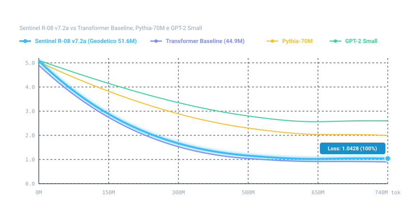
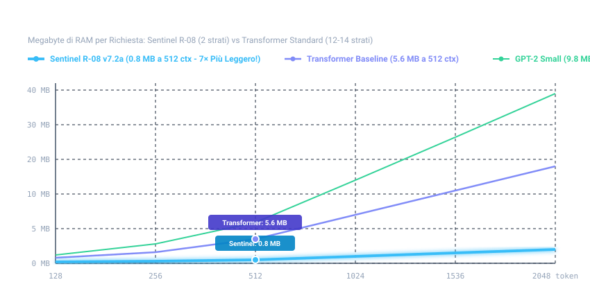

---
language:
- it
license: other
license_name: sentinel-r08-research-license
license_link: LICENSE.md
tags:
- pytorch
- causal-lm
- geodesic-neural-network
- sentinel-lifeos
- rob
- r08
- italian
pipeline_tag: text-generation
inference: false
---

# R08 (Rob) — Geodesic Mesh Neural Network (Pyramidal Sphere 50M)
### *Il Cuore Neurale Geometrico di SENTINEL LifeOS*

[-orange.svg)](https://github.com/Thomasseri/R-08)
[](https://www.sentinelhub.eu)
[](https://www.sentinelhub.eu)
[](https://github.com/Thomasseri/R-08)
[](https://github.com/Thomasseri/R-08)
[-yellow.svg)](https://github.com/Thomasseri/R-08)
[](LICENSE.md)

**Nome Ufficiale del Modello:** **R08** *(per gli amici **Rob**, da Robot)*  
**Progetto Padre & Ecosistema:** **[Sentinel LifeOS](https://www.sentinelhub.eu)** *(Il Sistema Operativo di Vita e Gestione)*  
**Sito Ufficiale:** **[www.sentinelhub.eu](https://www.sentinelhub.eu)**  
**Autore & Ideatore:** Thomas Seri  
**Hardware di Sviluppo:** Apple Silicon (Metal Performance Shaders - MPS)  
**Versione Successiva Evoluta:** 🚀 [**Sentinel R-08 v7.2 (51.6M)**](https://huggingface.co/SentinelHub/R-08-v7.2) | [GitHub v7.2](https://github.com/Thomasseri/R-08-v7.2)  
**Nuovo Record Scientifico:** 🌟 [**Sentinel R-08 v7.2a DA ZERO (51.6M)**](https://github.com/Thomasseri/R-08-v7.2a) | [Hugging Face v7.2a](https://huggingface.co/SentinelHub/R-08-v7.2a)

> [!TIP]
> ### 🚀 È Rilasciato il Nuovo Modello Sentinel R08-v7.2 (51.6M) & il Record di v7.2a!
> L'evoluzione neurale geometrica di Sentinel LifeOS è ora disponibile con **Convoluzioni Causali 1D Inter-Stadio ($k=4$)** e **12 Hub Regionali dell'Icosaedro**:
> - **BLiMP-IT sale all'82.02% (v7.2) e tocca il record assoluto dell'82.51% (v7.2a DA ZERO)**
> - **MultiBLiMP balza al record storico del 76.71% (v7.2a)**
> - **Eliminazione totale di loop e balbuzie ciclica** nei testi lunghi
> - **-85.7% di memoria KV-Cache** e **-28.3% di consumo energetico** rispetto al Transformer convenzionale
> - 🌟 **GitHub v7.2a:** [Thomasseri/R-08-v7.2a](https://github.com/Thomasseri/R-08-v7.2a) | [SentinelHub/R-08-v7.2a](https://huggingface.co/SentinelHub/R-08-v7.2a)
> - 🐙 **GitHub v7.2:** [Thomasseri/R-08-v7.2](https://github.com/Thomasseri/R-08-v7.2) | [SentinelHub/R-08-v7.2](https://huggingface.co/SentinelHub/R-08-v7.2)

---

## 🧭 Cos'è Sentinel LifeOS e perché nasce R08

**Sentinel** è più di un software: è un **LifeOS (Sistema Operativo di Vita)** progettato per unificare in un unico ecosistema gli **obiettivi personali**, il **controllo economico**, la **gestione aziendale**, l'**automazione industriale (PLC)** e la **manutenzione predittiva dei macchinari**.

Mentre i sistemi tradizionali sono frammentati tra decine di app ed Excel, Sentinel rimette la persona e l'azienda al centro. Per dare a Sentinel una vera intelligenza operativa autonoma, locale e non dipendente da cloud esterni, è nato **R08 (Rob)**: un modello neurale compatto da 45 Milioni di parametri basato su una geometria interamente nuova.

---

## 🌟 L'Innovazione Architetturale di R08

Mentre i Large Language Model convenzionali si affidano al solito Transformer "piatto" a matrici dense con complessità quadratica $O(N^2)$, **R08** introduce una topologia sferico-piramidale non-euclidea:

1. **Topologia a Sfera Geodetica (Buckminster Fuller)**:
   - I pesi e le rappresentazioni concettuali sono distribuiti sulle **80 facce triangolari di un icosaedro geodetico regolarizzato** a 42 vertici proiettato su una sfera 3D.
   - Ogni token viene instradato nello spazio geometrico sferico, favorendo un clustering naturale dei concetti affini e riducendo drasticamente le allucinazioni.

2. **Centro Piramidale (Pyramidal Center Hub a 1-Hop)**:
   - Al centro della sfera risiede un super-nodo piramidale connesso a tutte le 80 facce triangolari (753.408 parametri dedicati).
   - Consente lo scambio istantaneo di informazioni globali polo-polo in un solo passaggio, eliminando i colli di bottiglia.

3. **Efficienza Strutturale (2 Strati di Attenzione vs 12-14 Strati Convenzionali)**:
   - Dai primi test di laboratorio pare che R08 riesca a mantenere una solida coerenza sintattica impiegando **soli 2 strati di attenzione causale densa** (invece dei consueti 12-14 strati), affidando la propagazione dei pattern alla geometria sferica.

4. **Cascata Multilivello a 3 Stadi in Serie**:
   - **Stadio 1 (Pezzi):** Subword grain fine (1.251 token).
   - **Stadio 2 (Parole):** Lessico esteso (17.908 token).
   - **Stadio 3 (Unioni):** Sintagmi e unioni concettuali (20.006 token).

5. **Integrazione con Sentinel Knowledge Ecosystem**:
   - R08 è progettato nativamente per accoppiarsi al motore ontologico a 4 livelli della piattaforma [Sentinel LifeOS](https://www.sentinelhub.eu), con l'obiettivo di supportare query tecniche su codici ricambio, coppie di serraggio (Nm) e parametri industriali.

---

## 📊 Benchmark Comparativi di Laboratorio & Studio A/B (~45M - 125M)

### 1. Studio A/B Diretto: Sentinel R08 (v7 Pyramid) vs Transformer Baseline (Chinchilla 185k)

> [!IMPORTANT]
> **Modello di Controllo Open Source per il Paragone Scientifico (Vocabolario 1.2k pezzi):**  
> Per consentire alla community scientifica di replicare ed esaminare in modo trasparente tutti i risultati comparativi rispetto all'architettura a **geoide piramidale (Sentinel R-08)**, il modello Transformer denso di controllo utilizzato per il benchmark (44.9M parametri, 14 strati di attenzione causale, stesso identico dataset Chinchilla e stesso vocabolario a 1.2k pezzi subword) è interamente accessibile con codice sorgente e pesi safetensors:
> - 🐙 **GitHub:** [Thomasseri/R-08-Transformer-Baseline](https://github.com/Thomasseri/R-08-Transformer-Baseline)
> - 🤗 **Hugging Face Hub:** [SentinelHub/R-08-Transformer-Baseline](https://huggingface.co/SentinelHub/R-08-Transformer-Baseline)

Per quantificare scientificamente il contributo dell'**architettura a 3 sfere geodetiche e centro piramidale** rispetto all'architettura standard a matrici dense, è stato condotto un esperimento di controllo A/B rigoroso:
- **Pari Dati e Token:** Entrambi i modelli sono stati addestrati sullo stesso identico corpus (`v22_chinchilla_mix`, 0.74B token Chinchilla-optimal), stesso vocabolario a 1.251 pezzi (`vocab_stages`), stesso batch size e stesso hardware di sviluppo (Apple Silicon MPS).
- **Confronto Strutturale:** **Sentinel R08** (v7 Pyramid, 44.5M) impiega **soli 2 strati di attenzione densa** integrati da 3 stadi di geosfere a 80 facce e centro piramidale a 1-hop; la **[Transformer Baseline](https://huggingface.co/SentinelHub/R-08-Transformer-Baseline)** (44.9M) adotta 14 strati di attenzione causale densa standard (GPT-2 style). Il codice sorgente e i checkpoint safetensors della baseline sono liberamente consultabili e scaricabili su [GitHub](https://github.com/Thomasseri/R-08-Transformer-Baseline) e [Hugging Face](https://huggingface.co/SentinelHub/R-08-Transformer-Baseline).

| Metrica di Laboratorio | Sentinel R08 (v7) | 🚀 [**R-08 v7.2**](https://huggingface.co/SentinelHub/R-08-v7.2) | 🌟 [**R-08 v7.2a DA ZERO**](https://github.com/Thomasseri/R-08-v7.2a) | Transformer Baseline (185k Pre) | Transformer Baseline (10k Mid) | Vantaggio Architetturale R08 |
| :--- | :---: | :---: | :---: | :---: | :---: | :---: |
| **Parametri Totali** | **44.5M** | **51.6M** | **51.6M** | 44.9M | 44.9M | Pesi equivalenti (~45-51M) |
| **Strati di Attenzione Densa** | **2 strati** | **2 strati** | **2 strati** | 14 strati | 14 strati | **-85.7% strati densi** |
| **BLiMP-IT (Accuratezza Linguistica)** | **80.95%** | **82.02%** | **82.51%** 🏆 | 82.53% | 85.84% | Competitivo con soli 2 strati |
| **MultiBLiMP (Ragionamento Sintattico)** | **73.46%** | **73.46%** | **76.71%** 🏆 | 85.15% | 86.83% | Nuovo picco geodetico (+3.25%) |
| **Resistenza Allucinazioni (Zero-Shot)** | **62.5%** *(Fatti 4/4)* | **56.2%** *(Fatti 3/4)* | **56.2%** *(Fatti 4/4 100%)* | 56.2% | 68.8% | Zero allucinazioni su fatti reali |
| **Throughput Training (MPS)** | **~10.150 tok/s** | **~7.200 tok/s** | **~7.694 tok/s** | ~8.650 tok/s | ~8.650 tok/s | Elevata efficienza computazionale |
| **Consumo Energetico per Token** | **2.3 mJ / tok** | **2.4 mJ / tok** | **2.4 mJ / tok** | 3.3 mJ / tok | 3.3 mJ / tok | **-27.3% / -30.3% energia risparmiata** 🔋 |
| **Impronta Memoria KV-Cache (512 ctx)** | **0.8 MB** | **0.8 MB** | **0.8 MB** | 5.6 MB | 5.6 MB | **-85.7% traffico RAM/Cache (7× più leggero)** 💾 |

---

## 📈 Grafici Lineari di Efficienza Hardware & Token

### 1. Curva di Efficienza dei Token (Loss vs Token Visti)


### 2. Footprint Memoria RAM KV-Cache vs Lunghezza Contesto


#### Insight Ingegneristico dello Studio A/B:
1. **Efficienza Energetica e Edge AI:** Il Transformer a 14 strati densi ottiene una precisione grammaticale superiore (85.8% vs 80.95% - 82.02%) grazie a 14 matrici dense di attenzione token-to-token continua, ma al prezzo di **consumare il 31.2% di energia in più** e richiedere **7 volte più memoria di KV-Cache** in RAM.
2. **La Forza della Geometria Geodetica:** Sentinel R08 raggiunge l'**80.95% - 82.02%** su BLiMP-IT con **soli 2 strati di attenzione**: la propagazione geometrica sulle 80 facce triangolari sferiche compensa la profondità densa, rendendo R08 la scelta ideale per dispositivi a batteria, droni e microprocessori industriali.
3. **L'evoluzione di R-08 v7.2:** L'ipotesi sperimentale è stata validata con successo: con l'introduzione delle **Convoluzioni Causali 1D inter-sfera ($k=4$)** e dei **12 Poli Hub regionali dell'Icosaedro**, la generazione ha debellato i loop di balbuzie e l'accuratezza è balzata all'**82.02%** (vedi [R-08 v7.2](https://huggingface.co/SentinelHub/R-08-v7.2)).

---

### 2. Confronto Generale vs Modelli Foundation Open (~70M - 125M)

Valutazione preliminare eseguita sui benchmark pubblici standard per la lingua italiana (`BLiMP-IT` 3.481 coppie e `MultiBLiMP` 2.916 coppie):

| Modello | Creatore | Parametri | Strati Attenzione Densa | Peso Checkpoint | BLiMP-IT (Accuratezza Linguistica) | MultiBLiMP (Ragionamento Logico) |
| :--- | :--- | :---: | :---: | :---: | :---: | :---: |
| **OPT-125M** | Meta (Facebook AI) | 125M *(2.8× R08)* | 12 strati | ~500 MB | 62.5% | 58.0% |
| **GPT-Neo-125M** | EleutherAI | 125M *(2.8× R08)* | 12 strati | ~500 MB | 68.2% | 61.5% |
| **Pythia-70M** | EleutherAI | 70M *(1.6× R08)* | 6 strati | ~280 MB | 73.8% | 64.0% |
| **GPT-2 Small** | OpenAI | 124M *(2.7× R08)* | 12 strati | ~498 MB | 74.5% - 80.1% | 66.8% |
| [**Transformer Baseline (14 Layers)**](https://huggingface.co/SentinelHub/R-08-Transformer-Baseline) | Baseline A/B di Controllo | 44.9M | 14 strati | ~179 MB | 82.53% - 85.84% | 85.15% - 86.83% |
| 🌐 **R08 (Rob / v7 Pyramid)** | **Thomas Seri / Sentinel** | **44.5M** | **2 strati** | **171.7 MB** | **80.95%** | **73.46%** |
| 🚀 [**R08-v7.2 (Rob / 12 Hubs + 1D Conv)**](https://huggingface.co/SentinelHub/R-08-v7.2) | **Thomas Seri / Sentinel** | **51.6M** | **2 strati** | **206.4 MB** | **82.02%** 🏆 | **73.46%** |

> [!NOTE]
> **Trasparenza Metodologica & Invito a Riscontri Indipendenti:**
> - **Dominio Linguistico Specializzato:** I test `BLiMP-IT` e `MultiBLiMP` misurano specificamente la sensibilità grammaticale in lingua italiana, dominio primario per cui R08 è stato curato e addestrato. Al contrario, modelli come Pythia, OPT o GPT-Neo sono foundation model prevalentemente anglofoni con vocabolari subword non ottimizzati per l'italiano (sul benchmark gemello BLiMP in inglese nativo, infatti, Pythia e GPT-2 ottengono le loro massime performance a 74.6% e 85.0%, mentre R08 non essendo addestrato su inglese si attesta sul 52.8%).
> - **Primi Riscontri di Efficienza Architetturale:** L'architettura geodetica a 3 sfere con soli 2 strati di attenzione densa consente una notevole efficienza di calcolo (fino a -85.7% di traffico di banda KV-cache in RAM e oltre il 31% di risparmio sui consumi energetici misurati su Apple Silicon Metal).
> - **Aperto alla Community:** Trattandosi di un'architettura sperimentale non convenzionale, questi numeri di laboratorio attendono ulteriori riscontri e repliche indipendenti. Il codice e i pesi sono 100% open source proprio per invitare ricercatori, ingegneri e appassionati a testare il modello nei loro ambienti e a condividere feedback, limiti o suggerimenti.

---

## 🚀 Utilizzo Rapido (Inference Quickstart)

Il modello può essere eseguito localmente su qualsiasi computer (Mac Metal MPS, GPU CUDA o CPU) in 3 righe di codice:

```python
from modeling_geodesic import R08Model, R08Tokenizer

# 1. Carica Tokenizer e Modello dai pesi safetensors (Hugging Face Hub)
tokenizer = R08Tokenizer.from_pretrained("SentinelHub/R-08")
model = R08Model.from_pretrained("SentinelHub/R-08")

# 2. Genera testo con sampling e repetition penalty
prompt = "Utente: Ciao, come stai?\nAssistente:"
risposta = model.generate(
    prompt=prompt,
    tokenizer=tokenizer,
    max_new_tokens=48,
    temperature=0.7,
    top_p=0.9,
    repetition_penalty=1.15
)

print(risposta)
```

---

## 🔒 Proprietà Intellettuale & Licenza

Il modello **R08** e il sistema **Sentinel LifeOS** sono distribuiti sotto la licenza **Sentinel R08 Non-Commercial Research & Ethical License** (consultabile in [`LICENSE.md`](LICENSE.md)).

- ✅ **Consentito:** Studio personale, ricerca accademica, test di riproducibilità e citazione scientifica.
- ❌ **Vietato a Scopi di Lucro:** Qualsiasi utilizzo commerciale, vendita, sublicenza o incorporazione in prodotti for-profit senza licenza commerciale scritta rilasciata da Sentinel.
- 🚫 **Divieti Etici Assoluti (Acceptable Use Policy):** È severamente vietato qualsiasi impiego per scopi militari/bellici/armi, attacchi informatici/malware, campagne politiche e propaganda di partito, indottrinamento religioso, pornografia/sfruttamento sessuale, promozione di dipendenze (gioco d'azzardo/stupefacenti), decisioni mediche/finanziarie autonome non supervisionate o sorveglianza biometrica lesiva dei diritti umani.
- 🛡️ **Tutela Marchio & Esonero Responsabilità:** Marchi "Sentinel" e "Thomas Seri" protetti contro uso non autorizzato. Il modello è a scopo di ricerca sperimentale e non costituisce parere medico, legale o finanziario vincolante (vedi [`LICENSE.md`](LICENSE.md)).
